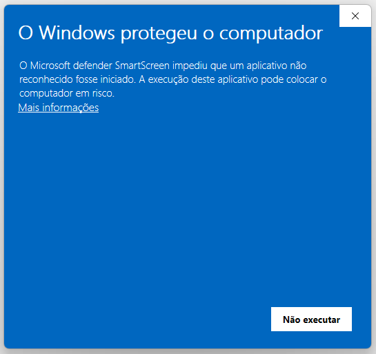
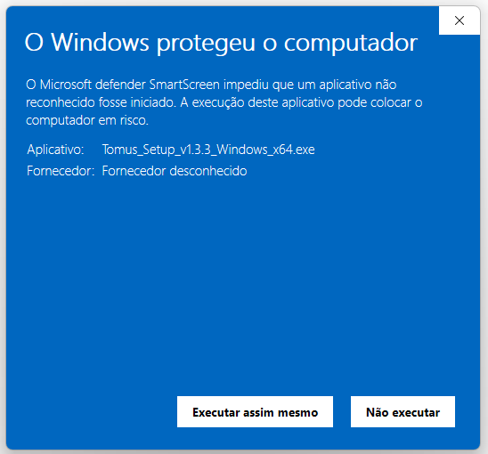

<p align="center">
  
</p>

# Tomus — Organizador Acadêmico de PDFs

[](LICENSE)
[](#como-baixar-e-instalar)
[](#apoie-o-projeto-doação-voluntária)
[](https://www.python/)

O **Tomus** é uma aplicação desktop acadêmica livre e gratuita projetada para automatizar a triagem, enriquecimento bibliográfico, padronização de nomes e catalogação temática de acervos de PDFs.

Ele organiza seus documentos diretamente em seu computador conforme a taxonomia oficial de áreas do conhecimento da **CAPES/CNPq** e gera arquivos de metadados complementares (`.md`) com fichamento e referências completas estritamente formatadas segundo a norma **ABNT NBR 6023**, incluindo suporte a **Revistas/Periódicos (Artigo)** com citação de periódico, volume, número e páginas.

```
<Destino>/<Área Básica>/<Subárea>/<Tipo>/<Autor> - <Título> - <Ano>.pdf
<Destino>/duplicatas/   (exemplares repetidos da mesma edição)
<Destino>/obsoletos/    (edições antigas superadas por edição mais recente)
<Destino>/revisao_manual/
```

## 🌐 Portal Oficial & Documentação

* **Landing Page Oficial:** [dcprj.github.io/tomus](https://dcprj.github.io/tomus/)
* **Manual do Usuário:** [Versão Web](https://dcprj.github.io/tomus/manual_do_usuario.html) · [Markdown (`docs/produto/MANUAL_DO_USUARIO.md`)](docs/produto/MANUAL_DO_USUARIO.md)
* **Documentação Técnica & Arquitetura:** [Versão Web](https://dcprj.github.io/tomus/documentacao_tecnica.html) · [Markdown (`docs/produto/DOCUMENTACAO_TECNICA.md`)](docs/produto/DOCUMENTACAO_TECNICA.md)

---

## 📥 Como Baixar e Instalar

Você não precisa instalar Python nem configurar ambientes complexos para usar o Tomus. Baixe o instalador nativo pronto para **macOS** ou **Windows** na seção de **[Releases](https://github.com/dcprj/tomus/releases)** (tag `v1.4.2`):

**Requisitos de plataforma:**
* **macOS 14+** (Apple Silicon ou Intel)
* **Windows 10/11** (64 bits)

| Sistema Operacional | Formato do Pacote | Link de Download Direto (v1.4.2) |
| :--- | :--- | :--- |
| **macOS** (Apple Silicon / Intel) | `.dmg` (arraste para `/Applications`) | [Baixar Tomus-1.4.2-macOS.dmg](https://github.com/dcprj/tomus/releases/download/v1.4.2/Tomus-1.4.2-macOS.dmg) |
| **Windows 10/11** (x64) | `.exe` (Inno Setup, sem administrador) | [Baixar Tomus_Setup_v1.4.2_Windows_x64.exe](https://github.com/dcprj/tomus/releases/download/v1.4.2/Tomus_Setup_v1.4.2_Windows_x64.exe) |

> [!TIP]
> Sempre prefira os assets oficiais da release [v1.4.2](https://github.com/dcprj/tomus/releases/tag/v1.4.2) ou da página [latest](https://github.com/dcprj/tomus/releases/latest). Não execute instaladores de fontes terceiras.

---

### 1. Instalação no macOS

1. Baixe o arquivo oficial `Tomus-1.4.2-macOS.dmg`.
2. Dê duplo clique no arquivo `.dmg` baixado para abri-lo.
3. Arraste o ícone do aplicativo para a pasta **Applications (Aplicativos)**.

> [!IMPORTANT]
> **Primeira Execução no macOS (Aviso do Gatekeeper):**  
> Como o Tomus é distribuído de forma independente, o macOS pode exibir um aviso de *"desenvolvedor não identificado"* ao abrir o aplicativo pela primeira vez.  
> Para abrir, siga o procedimento oficial da Apple para abrir apps de desenvolvedores não identificados:  
> 1. Clique com o botão direito (ou pressione `Control` + clique) no ícone do Tomus na pasta **Aplicativos** e selecione **Abrir**.  
> 2. Se o aviso persistir, vá em **Ajustes do Sistema > Privacidade e Segurança**, role até a seção de segurança e clique em **Abrir Mesmo Assim** ao lado do nome do Tomus.  
> 3. Na janela de confirmação, clique em **Abrir**.  
>
> Referência oficial da Apple: https://support.apple.com/en-us/102445

---

### 2. Instalação no Windows

O instalador para Windows é gerado com **Inno Setup** e é uma instalação **por usuário**: não exige senha nem privilégios de administrador.

#### 2.1 Baixar o instalador oficial

Acesse a seção de **[Releases](https://github.com/dcprj/tomus/releases)** e baixe o instalador oficial para Windows. Sempre prefira os assets oficiais do repositório dcprj/tomus — não execute instaladores de fontes terceiras.

O nome do arquivo segue o padrão `Tomus_Setup_v<versao>_Windows_x64.exe` (por exemplo, `Tomus_Setup_v1.4.2_Windows_x64.exe` na release v1.4.2 vigente). Confira que o nome e a versão exibidos coincidem com o asset oficial da release do GitHub.

#### 2.2 Confirmação de procedência

Antes de abrir o instalador, verifique que o arquivo baixado é o asset oficial liberado na página de Releases do GitHub. O SmartScreen do Windows pode exibir o fornecedor como "desconhecido" — isso é esperado para aplicativos independentes distribuídos sem certificado pago Authenticode EV e **não** significa que o arquivo seja inseguro. Não há exigência de certificado EV para usar o Tomus.

#### 2.3 Executar o instalador

Dê duplo clique no arquivo `.exe` baixado. O assistente de instalação do Inno Setup será aberto.

#### 2.4 Aviso do Windows Defender SmartScreen (verificação de procedência)

Se o Windows Defender SmartScreen exibir um aviso na primeira execução, isso é um procedimento normal de verificação de procedência para aplicativos independentes distribuídos sem certificado pago Authenticode EV. **Não desative o SmartScreen** e não considere um certificado EV como condição necessária para usar o Tomus. Um fornecedor exibido como "desconhecido" no aviso **não comprova nem invalida a segurança do binário** — é simplesmente um aviso de procedência para software independente.

Para prosseguir na instalação:

1. Clique em **Mais informações** para expandir os detalhes do aviso.
2. Clique em **Executar assim mesmo** para continuar a instalação.

Essa confirmação costuma ser necessária apenas na primeira abertura do instalador.





> [!NOTE]
> As capturas acima mostram o instalador **v1.4.2** (versão publicada na release do GitHub). O nome do arquivo exibido pode variar conforme a versão disponível; sempre confira o nome exato do arquivo baixado no asset oficial da release.

#### 2.5 Seguir o assistente de instalação

Siga o assistente: aceite os termos, escolha a pasta de destino (padrão: `%LocalAppData%\Programs\Tomus`) e marque, se desejar, o atalho opcional na **Área de Trabalho**. Atalhos são criados automaticamente no **Menu Iniciar**.

#### 2.6 Concluir e abrir o Tomus

Conclua a instalação e inicie o Tomus pelo Menu Iniciar ou pelo atalho da Área de Trabalho.

---

### 3. Desinstalação (macOS e Windows)

**macOS**
1. Arraste o aplicativo **Tomus.app** da pasta **Aplicativos** para o **Lixo**.
2. Esvazie o Lixo para concluir a remoção.

> **Limpeza opcional de dados locais:** A desinstalação remove o programa, mas mantém seus dados de usuário. Se quiser remover também configurações, cache e logs, delete manualmente as pastas:
> * `~/.config/tomus`
> * `~/.cache/tomus`
> * `~/.tomus`

**Windows**
1. Abra **Configurações > Aplicativos > Aplicativos instalados**.
2. Selecione **Tomus** na lista e clique em **Desinstalar**.
3. Alternativamente, execute `unins000.exe` diretamente na pasta de instalação do Tomus (padrão: `%LocalAppData%\Programs\Tomus`).

> **Limpeza opcional de dados locais:** A desinstalação remove o programa, mas mantém seus dados de usuário. Se quiser remover também configurações, cache e logs, delete manualmente as pastas:
> * `%USERPROFILE%\.config\tomus`
> * `%USERPROFILE%\.cache\tomus`
> * `%USERPROFILE%\.tomus`

---

### 4. Instalação via Python / Terminal (Desenvolvedores)

Se você é desenvolvedor ou prefere executar o Tomus via ambiente Python:

**macOS / Linux:**
```bash
# Clonar o repositório
git clone https://github.com/dcprj/tomus.git
cd tomus

# Criar e ativar ambiente virtual
python3 -m venv .venv
source .venv/bin/activate

# Instalar dependências
pip install -e ".[dev]"

# Iniciar a interface gráfica (Desktop GUI)
tomus-gui
# ou:
tomus gui
```

**Windows (PowerShell):**
```powershell
# Clonar o repositório
git clone https://github.com/dcprj/tomus.git
cd tomus

# Criar e ativar ambiente virtual
python -m venv .venv
.venv\Scripts\Activate.ps1

# Instalar dependências
pip install -e ".[dev]"

# Iniciar a interface gráfica (Desktop GUI)
tomus-gui
# ou:
tomus gui
```

---

## 5. Primeiro Uso do Tomus — Guia Didático

Esta seção é para quem está usando o Tomus pela primeira vez e não tem familiaridade com chaves de API ou modelos de linguagem (LLM). Não é necessário saber programar nem entender de inteligência artificial para começar.

### 1. Baixe o instalador oficial

Acesse a seção de **[Releases](https://github.com/dcprj/tomus/releases)** e baixe o instalador oficial para o seu sistema: `.dmg` no macOS ou `.exe` no Windows. Não é necessário instalar Python nem configurar ambientes complexos. Consulte as seções 1 e 2 acima para detalhes de cada plataforma.

### 2. Instale e abra

No Windows, execute o instalador `.exe` e siga o assistente do Inno Setup. Se o **Windows Defender SmartScreen** exibir um aviso, clique em **Mais informações** e depois em **Executar assim mesmo**. No macOS, arraste o ícone **Tomus.app** para a pasta **Aplicativos** e, se o Gatekeeper exibir um aviso, clique com o botão direito no ícone e selecione **Abrir** (veja o procedimento oficial da Apple em [macOS Gatekeeper](https://support.apple.com/en-us/102445)).

### 3. Crie uma chave de IA

Acesse o site de um provedor de inteligência artificial (por exemplo, [Google AI Studio](https://aistudio.google.com/)) e siga os passos abaixo para obter sua chave de API:

1. Abra o Google AI Studio e faça login com sua conta.
2. Clique em **"Get API key"** ou **"Create API key"**.
3. Crie uma nova chave de API.
4. Copie a chave gerada (começa com `AIza...`).

Ela é só sua e serve para conectar o Tomus ao modelo de linguagem. Cada provedor define suas próprias regras de uso, cota e preços — consulte o site de cada provedor antes de criar a chave. Você deve guardá-la com cuidado, como faria com uma senha.

> [!WARNING]
> **Groq — use apenas como reserva de fallback (não como provedor principal).** O Groq não exige cartão de crédito, mas sua cota gratuita é restrita a **8.000 tokens por minuto (TPM)** e **200.000 tokens por dia (TPD)**. O uso isolado como principal em lotes médios/grandes esgota rapidamente a cota e torna o processamento mais lento por causa do cadenciamento. Recomendamos configurar o **Google Gemini** ou o **NVIDIA NIM** como provedor principal gratuito e deixar o **Groq apenas na cadeia de fallback**, para que o Tomus acione o Groq automaticamente se o principal atingir o limite.

### 4. Insira a chave

Abra o Tomus, clique no ícone de **engrenagem** (Preferências) na barra superior e vá para a aba **Credenciais e Chaves de API**. Cole a chave no campo correspondente (por exemplo, **Google Gemini API Key**), clique em **Testar** para verificar se a chave funciona e, só então, clique em **Salvar Configuração**. A chave é gravada exclusivamente no disco local do seu computador. Não compartilhe sua chave com outras pessoas. Na aba **Provedores LLM & Fallback**, escolha o provedor de linguagem que você deseja utilizar.

### 5. Escolha pastas e teste

1. Defina a **Origem** (pasta com seus PDFs) e o **Destino** (onde o Tomus organizará a cópia).
2. Use o modo **Copiar** para manter os arquivos originais intactos.
3. Comece com um teste pequeno de poucos arquivos.
4. Ative a **Simulação (Dry-Run)** para conferir os resultados antes de processar um acervo maior — no modo simulação nenhum arquivo é movido ou renomeado de verdade.
5. Clique em **Organizar Acervo** e confira o resultado na grade.
6. Revise os arquivos que o Tomus não conseguiu classificar com confiança — eles ficarão na pasta de revisão manual para você ajustar.

O PDF original fica no seu computador; uma amostra de texto e informações do documento podem ser enviadas ao provedor de IA que você escolheu, e consultas bibliográficas também podem ocorrer por serviços externos. Cada PDF organizado é acompanhado por um arquivo `.md` com metadados, incluindo ficha catalográfica formatada conforme a norma ABNT NBR 6023.

### 6. Google Books (opcional)

Busca dados bibliográficos de livros (capa, editora, ano) usando uma chave criada no **Google Cloud Console**:

1. Acesse o [Google Cloud Console](https://console.cloud.google.com/).
2. Crie ou selecione um projeto.
3. Ative a **Google Books API** para esse projeto.
4. Crie uma credencial do tipo **Chave de API** e **restrinja-a à API do Google Books**.
5. Copie a chave gerada.
6. No Tomus, abra **Preferências > Credenciais e Chaves de API**, cole a chave no campo **Google Books API Key**, clique em **Testar** e depois em **Salvar Configuração**.

Essa chave é usada apenas para consultar metadados de livros (especialmente via ISBN) e **não substitui** a chave de IA (Google Gemini, Groq, DeepSeek ou NVIDIA) usada para classificação de texto. O campo é tratado opcionalmente pelo Tomus. Sem ele, o enriquecimento por ISBN pode não funcionar. A documentação do Google pede que as chamadas sejam identificadas, mas não há garantia de cota ou gratuidade fixa — consulte os termos do provedor.

### O que acontece com seus dados

* **Seus PDFs permanecem no seu computador.** O arquivo integral nunca é enviado para a nuvem.
* **Um pequeno trecho de texto** (por exemplo, primeiras e últimas páginas, como folha de rosto e sumário) **e informações bibliográficas e nome do arquivo** podem ser enviados para a API de IA que você escolheu, para classificação e geração de metadados. Outros serviços de metadados (por exemplo, OpenAlex, Crossref, Google Books) também podem receber consultas para enriquecimento de metadados, mesmo sem chave de IA configurada.
* **Sem uma chave de IA**, o Tomus usa classificação simulada (fictícia) para categorizar os documentos, mas consultas de enriquecimento de metadados podem ainda ocorrer por serviços externos conforme sua configuração.

> [!IMPORTANT]
> Cada provedor de IA define suas próprias regras de uso, cota e preços, que podem mudar a qualquer momento. Consulte os termos de cada provedor antes de criar ou usar uma chave.
>
> A classificação depende da qualidade do texto extraído do PDF e do modelo de IA usado. Sempre revise os resultados, especialmente em acervos importantes.
>
> **Modo simulado:** sem uma chave de IA válida, o Tomus funciona em modo simulado e gera metadados fictícios. Esse modo é útil para conhecer a interface, mas não deve ser usado para catalogar um acervo de verdade.

---

## 7. ☕ Apoie o Projeto (Doação Voluntária)

O **Tomus** é uma iniciativa independente, de código aberto e **100% gratuita**. Ele foi concebido para fortalecer a pesquisa científica e poupar semanas de trabalho manual repetitivo de pesquisadores, estudantes e instituições.

Se o Tomus foi útil para sua dissertação, tese ou organização bibliográfica e você deseja demonstrar sua gratidão e incentivar a manutenção e novas funcionalidades, você pode fazer uma **contribuição espontânea de qualquer valor**:

* **Chave Pix (Brasil):** `dpinheiro+tomus@gmail.com`
* **Código-fonte no GitHub:** [Repositório Oficial dcprj/tomus](https://github.com/dcprj/tomus)

> [!NOTE]
> **Esclarecimento Jurídico (Doação Pura):**  
> Toda contribuição financeira voluntária configura estritamente **Doação Pura e Simples**, nos termos do **Art. 538 do Código Civil Brasileiro** (Lei Federal nº 10.406/2002). A doação não constitui contraprestação mercantil, compra de software, contratação de serviços ou suporte comercial com SLA. Todos os usuários têm acesso irrestrito às mesmas versões e recursos do Tomus sem distinção.

---

## 🔒 Privacidade, Transparência e Proteção de Dados (LGPD & GDPR)

O Tomus adota uma política de **Transparência Técnica e Ética Integral** sobre como os seus documentos são manipulados:

* **Arquivos PDF 100% no seu Disco Local:** O arquivo binário do PDF integral, seus capítulos completos e dados brutos de pesquisa **nunca saem do seu computador** nem são enviados para servidores em nuvem. A extração inicial e o OCR rodam exclusivamente no processador e na memória da sua máquina, de forma multiplataforma (macOS e Windows), via **PyMuPDF + RapidOCR/ONNXRuntime**.
* **Envio Estrito de Dados de Catalogação para a IA:** Para determinar a área do conhecimento na taxonomia CAPES e formatar a citação ABNT NBR 6023, o Tomus extrai um **recorte textual reduzido** (amostra das primeiras e últimas páginas, como folha de rosto, sumário e ficha catalográfica) e o submete via HTTPS/TLS diretamente à API do provedor de IA configurado por você (Google Gemini, Claude, DeepSeek, Groq ou NVIDIA NIM).
* **Modelo BYOK (Bring Your Own Key):** Suas chaves de autenticação de API residem no seu computador (com permissão `0600` no macOS/Linux; armazenadas na pasta do perfil do usuário no Windows) e a comunicação é ponto a ponto direta com o provedor escolhido. O Tomus **não possui servidores intermediários** e **não realiza nenhuma telemetria** ou coleta de dados analíticos.
* **Controlador dos Dados:** Perante a Lei Geral de Proteção de Dados (LGPD - Lei nº 13.709/2018), o usuário atua como único Controlador dos documentos e conteúdos que submeter ao processamento.

---

## ⚠️ Isenção de Responsabilidade e Política de Backup

> [!WARNING]
> **AVISO MANDATÓRIO DE SEGURANÇA (BACKUP):**  
> O Tomus executa operações de leitura, cópia, movimentação e renomeação em massa de arquivos digitais no sistema de arquivos local. Embora o aplicativo incorpore mecanismos rigorosos de salvaguarda (como sanitização de caracteres proibidos pelo sistema operacional, validação criptográfica de integridade SHA-256 e modo de simulação prévia `--dry-run`), o software é disponibilizado **"no estado em que se encontra" (*as-is*)**, sem garantias de qualquer natureza.  
> 
> **É responsabilidade exclusiva e indelegável do usuário manter cópias de segurança (backup) completas e atualizadas de seus acervos antes de processar pastas em lote.** Os desenvolvedores e colaboradores do Tomus ficam expressamente isentos de qualquer responsabilidade civil por eventuais perdas, exclusões ou corrupções de arquivos decorrentes de interrupções de energia, falhas físicas de hardware, permissões do sistema operacional ou interpretações automatizadas dos modelos de linguagem.

---

## ⚖️ Licença

Este projeto é software livre distribuído sob os termos da **[Licença MIT](LICENSE)** combinada com os Termos Complementares de Jurisdição Brasileira e Isenção de Responsabilidade. Consulte o arquivo [LICENSE](LICENSE) e o parecer jurídico detalhado em [`docs/produto/legal_distribution_framework.md`](docs/produto/legal_distribution_framework.md).

*Marcas citadas (CAPES, CNPq, Google, Anthropic, DeepSeek, Groq, NVIDIA, OpenAlex) pertencem aos seus respectivos titulares e são mencionadas exclusivamente com finalidade de identificação e interoperabilidade técnica (Uso Nominativo e Justo, Art. 132 da LPI).*
