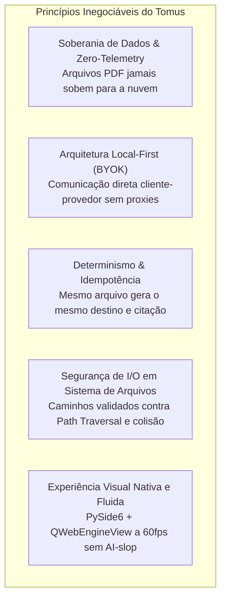
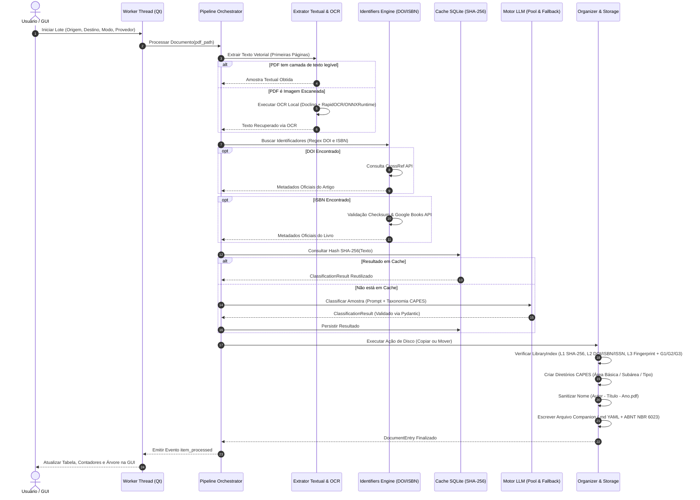
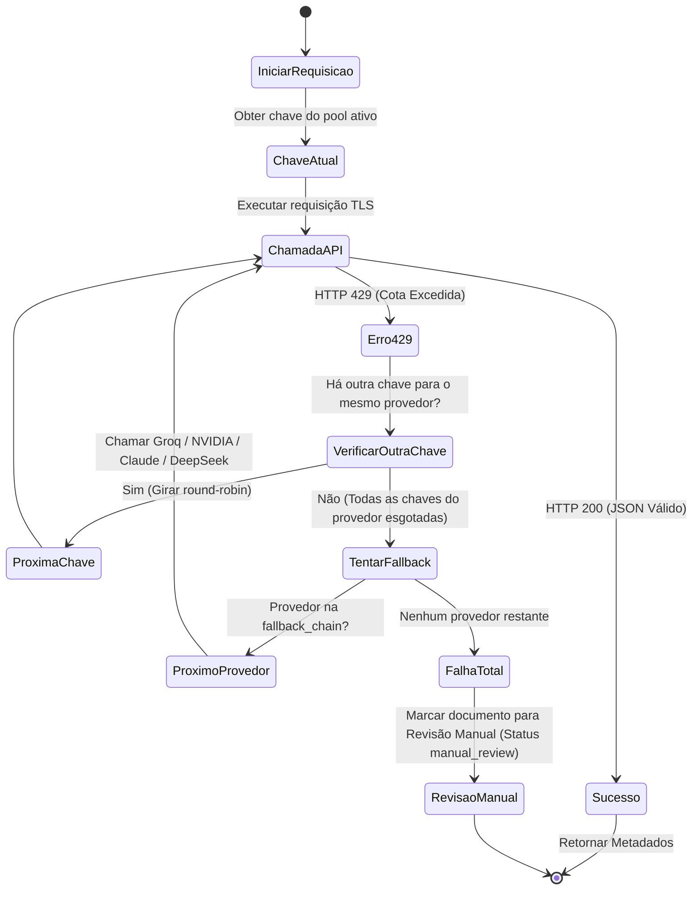

# Documentação Técnica e Arquitetura do Tomus

> **Versão da Especificação:** 1.3.2  
> **Status:** Ativa / Homologada  
> **Autores:** Dario Pinheiro (Arquiteto-Chefe & Mantenedor) e Equipe de Engenharia Tomus  
> **Licença:** Código Aberto sob [MIT License](https://github.com/dcprj/tomus/blob/main/LICENSE)  
> **Público-Alvo:** Engenheiros de software, arquitetos de sistemas, pesquisadores e desenvolvedores interessados no funcionamento interno, segurança, algoritmos e extensibilidade da bancada.

---

## 1. Visão Geral e Filosofia Arquitetural

O **Tomus** é uma aplicação desktop de alta fidelidade desenvolvida para **macOS e Windows** (suporte multiplataforma em camadas desacopladas), concebida para sanar o problema da entropia documental em acervos científicos e acadêmicos.

A grande maioria dos pesquisadores, professores e instituições acumula centenas ou milhares de arquivos em formato PDF com denominações crípticas (e.g., `download (1).pdf`, `artigo_final_v3.pdf`, `1-s2.0-S0140673620301835-main.pdf`), espalhados em pastas sem hierarquia ontológica.

O Tomus atua como uma esteira autônoma e determinística de engenharia da informação, combinando:
1. **Extração de Texto Híbrida e Local:** Camada textual embutida (PyMuPDF) aliada ao OCR seletivo local multiplataforma via **Docling + RapidOCR + ONNXRuntime** (backend `PyPdfiumDocumentBackend` no Windows, padrão do Docling no macOS), com fallback seguro que retorna texto vazio sem quebrar o processo.
2. **Identificadores Persistentes da Ciência:** Resolução exata de metadados via regex e APIs REST de identificadores globais (DOI via CrossRef e ISBN-10/ISBN-13 com validação de checksum via Google Books API).
3. **Classificação Ontológica Oficial:** Mapeamento em 4 níveis da tabela de áreas do conhecimento **CAPES/CNPq** (*Grande Área › Área Básica › Subárea › Especialidade*).
4. **Inteligência Artificial Local-First (BYOK):** Inferência semântica com múltiplos provedores em nuvem via TLS direto (*Bring Your Own Key*), operando com pool rotativo multi-chave, circuit breaker para erro 429 (*Too Many Requests*) e cascata automática de fallback.
5. **Renomeação Determinística e Fichamento Canônico:** Padronização nominal rigorosa de arquivos no sistema de arquivos (`Autor - Título - Ano.pdf`) e geração de arquivo companheiro `.md` com citação bibliográfica formatada segundo a **ABNT NBR 6023**.

### 1.1 Princípios Fundamentais de Engenharia



* **Soberania Absoluta e Privacidade:** Nenhum arquivo PDF, imagem ou conteúdo integral de documento é transmitido para servidores proprietários ou intermediários. O Tomus não possui servidores de backend próprios, bancos de dados em nuvem, nem sistemas de telemetria analítica.
* **Envio Mínimo e Estrito de Metadados:** Quando a inteligência artificial é acionada, apenas uma amostra sintética textual das primeiras páginas (suficiente para capturar título, folha de rosto, cabeçalho, autoria e resumo) é formatada e enviada via TLS diretamente aos endpoints oficiais dos provedores contratados pelo próprio usuário.
* **Idempotência e Cache Criptográfico:** Cada bloco de texto extraído é indexado localmente por seu hash SHA-256 em banco SQLite local (`~/.cache/tomus/cache.db`). A re-execução sobre acervos previamente processados opera com custo zero e latência milimétrica.

---

## 2. Stack Tecnológica e Decisões de Engenharia

O projeto adota uma stack moderna, minimalista e pragmática, priorizando robustez, velocidade de execução e baixo consumo de recursos no macOS e no Windows.

```
┌────────────────────────────────────────────────────────────────────────┐
│                        Camada de Apresentação (GUI)                    │
│   PySide6 (Qt 6.8+) │ QWebEngineView (Chromium) │ QWebChannel (IPC)    │
│   HTML5 Semântico │ CSS Moderno (Design Tokens) │ Vanilla JavaScript  │
├────────────────────────────────────────────────────────────────────────┤
│                     Camada de Orquestração & CLI                       │
│        Typer + Rich │ Threads de Trabalho Qt (QThread)                 │
├────────────────────────────────────────────────────────────────────────┤
│                       Camada do Motor Central (Core)                   │
│   Pipeline Reativo │ Pydantic v2 (Schemas) │ SQLite (Cache & Hash)    │
│   Pool Multi-Chave & Circuit Breaker │ Rotação Automática de Fallback │
├────────────────────────────────────────────────────────────────────────┤
│                 Camada de Extração Textual & Visão                     │
│   PyMuPDF (fitz) │ Docling │ RapidOCR │ ONNXRuntime                   │
│   PyPdfiumDocumentBackend (Windows) │ Identificadores (DOI / ISBN)   │
├────────────────────────────────────────────────────────────────────────┤
│                  Camada de Armazenamento e Sistema Operacional         │
│   pathlib │ shutil (Atomic I/O) │ os_integration.py (open / os.startfile│
│   SHOpenFolderAndSelectItems via ctypes no Windows / xdg-open no Linux)│
└────────────────────────────────────────────────────────────────────────┘
```

### 2.1 Detalhamento dos Componentes e Bibliotecas

| Componente | Tecnologia / Biblioteca | Função no Sistema | Justificativa da Decisão Técnica |
| :--- | :--- | :--- | :--- |
| **Linguagem & Runtime** | Python 3.11+ (CPython) | Núcleo de execução do software | `requires-python = ">=3.11"` em `pyproject.toml`; suporte a tipos genéricos modernos (`X \| Y`), alta performance e compatibilidade com ecossistema de dados. |
| **Framework Gráfico** | `PySide6` (Qt for Python 6.8+) | Shell desktop nativo macOS e Windows | Ciclo de vida de aplicação nativa, menus globais, integração com `QThread`, atalhos de teclado e janelas nativas nos dois sistemas. |
| **Renderizador Web** | `PySide6.QtWebEngineWidgets` | Visualização da bancada interativa | Interface com alta densidade de informação, aceleração gráfica via GPU, CSS Grid/Flexbox e tipografia avançada sem bugs de layout. |
| **Ponte IPC (Qt-JS)** | `PySide6.QtWebChannel` | Canal de transporte seguro entre Python e Web | Comunicação assíncrona bidirecional tipada via JSON, eliminando servidores HTTP locais (`localhost`) e vetores de ataque CSRF. |
| **Validação de Dados** | `pydantic` (v2.10+) | Modelagem estrita de metadados e schemas LLM | Validação de alta velocidade escrita em Rust, serialização segura e sanitização de respostas de modelos de linguagem. |
| **Extração de PDF** | `PyMuPDF` (`fitz` 1.25+) | Parser de documento, texto vetorial e imagens | A mais rápida biblioteca de processamento de PDFs para Python; processa centenas de páginas por segundo sem vazamento de memória. |
| **OCR de Layout (Docling / RapidOCR)** | `docling` + `opencv-python-headless` (< 4.11), `rapidocr` e `onnxruntime` | OCR seletivo de páginas escaneadas (primeiras 8 e últimas 2) | No Windows usa `PyPdfiumDocumentBackend` do docling (evita access violation intermitente do parser nativo docling-parse); `cv2.setNumThreads(0)` e `OPENCV_FOR_THREADS_NUM=1` evitam contenção de threads com onnxruntime em bundles congelados PyInstaller; fallback seguro retorna texto vazio sem quebrar o processo. |
| **Cliente HTTP / APIs**| `httpx` (0.28+) com HTTP/2 e TLS 1.3 | Comunicação com provedores de IA e metadados | Suporte nativo a chamadas síncronas e assíncronas, pools de conexão e controle fino de timeouts para evitar travamentos de rede. |
| **Persistência de Cache**| `sqlite3` (embutido na stdlib) | Cache local de extração e classificação | Banco relacional serverless, ACID, sem dependências externas, garantindo recuperação instantânea de sessões e integridade de dados. |
| **CLI & Terminal** | `typer` + `rich` | Interface de linha de comando para automação | Ponto de entrada `tomus = "tomus.cli.main:app"` em `pyproject.toml`; execução headless, pipelines de laboratório e automações via shell script/PowerShell com logs coloridos. |
| **Empacotamento macOS**| `pyinstaller` (6.11+) + `create-dmg` / `hdiutil` | Geração de `.app` e imagem de disco `.dmg` | `packaging/build_macos.sh` + `packaging/smoke_check_macos.py`; `.app` assinado ad-hoc e DMG com atalho para `/Applications`. |
| **Empacotamento Windows**| `pyinstaller` + Inno Setup (`ISCC`) | Geração do instalador `.exe` | `packaging/build_windows.ps1` + `packaging/smoke_check_windows.py` + `packaging/windows_installer.iss` (`PrivilegesRequired=lowest`, `SolidCompression=no`, `x64compatible`, `unins000.exe`). |

---

## 3. Arquitetura de Camadas e Módulos do Sistema

O código-fonte do Tomus é estruturado sob o pacote principal `tomus`, com estrita separação de responsabilidades:

```
src/tomus/
├── cli/                 # Interface de Linha de Comando (CLI)
│   ├── main.py          # Ponto de entrada Typer + Rich (subcomandos run, config, cache)
│   └── presenter.py     # Renderização visual no terminal com Rich (tabelas, progresso)
├── core/                # Motor de Negócio e Engenharia (agnóstico de interface)
│   ├── config.py        # Configuração Pydantic (TOML, pool de chaves, fallbacks, caminhos por SO)
│   ├── llm.py           # Provedores de IA (Gemini, Groq, NVIDIA, DeepSeek, Claude)
│   ├── models.py        # Schemas Pydantic (ClassificationResult, DocumentEntry)
│   ├── namer.py         # Algoritmos de higienização de nomes e ABNT NBR 6023
│   ├── pipeline.py      # Orquestrador da esteira de processamento por documento
│   ├── prompts.py       # Engenharia de prompts com injeção estruturada da taxonomia
│   ├── taxonomy.py      # Árvore oficial CAPES/CNPq de 4 níveis e normalização
│   └── cache.py         # Cache de extração e classificação em SQLite
├── extractors/          # Motores de Ingestão de Conteúdo e Visão
│   ├── text_extractor.py# Extração vetorial inteligente via PyMuPDF
│   ├── ocr_docling.py   # OCR seletivo via Docling + RapidOCR/ONNXRuntime (PyPdfiumDocumentBackend no Windows)
│   └── identifiers.py   # Varredura e resolução de DOI (CrossRef) e ISBN (Google Books)
├── storage/             # Operações de Disco, Integridade e Companions
│   ├── organizer.py     # Execução atômica, LibraryIndex 3 camadas, duplicatas/ e obsoletos/
│   └── companion.py     # Geração de arquivos companheiros (.md com YAML e ABNT NBR 6023)
└── gui/                 # Interface Gráfica Desktop
    ├── app.py           # Ponto de entrada PySide6 e inicialização do loop de eventos
    ├── main_window.py   # Janela principal QMainWindow contendo QWebEngineView
    ├── bridge.py        # Ponte QWebChannel (Slots e Signals expostos ao JavaScript)
    ├── os_integration.py# Integração com SO: open / os.startfile / SHOpenFolderAndSelectItems (ctypes, Windows) / xdg-open
    ├── worker.py        # QThread de processamento assíncrono em segundo plano
    ├── widgets/         # Componentes auxiliares (Preferências, Cache, Toolbar nativa)
    └── web/             # Aplicação Web Frontend desacoplada
        ├── index.html   # Estrutura semântica da bancada de trabalho
        ├── style.css    # Design System Tomus (Tokens CSS, tema refinado)
        └── app.js       # Estado reativo e renderização em Vanilla JS
```

---

## 4. O Pipeline de Processamento (Esteira de Documentos)

A esteira de catalogação é o coração funcional do Tomus. Cada arquivo PDF passa por um fluxo sequencial e defensivo, garantindo que mesmo documentos corrompidos ou malformatados sejam tratados graciosamente sem travar a aplicação.



---

## 5. Engenharia da Taxonomia CAPES/CNPq

O Tomus adota formalmente a **Tabela de Áreas do Conhecimento da Coordenação de Aperfeiçoamento de Pessoal de Nível Superior (CAPES)** e do **Conselho Nacional de Desenvolvimento Científico e Tecnológico (CNPq)**.

### 5.1 A Árvore de 4 Níveis

A hierarquia taxonômica implementada em `tomus.core.taxonomy` estrutura os saberes humanos em quatro camadas:
1. **Grande Área:** As 8 grandes divisões do saber (e.g., *Ciências Exatas e da Terra*, *Ciências Humanas*, *Linguística, Letras e Artes*, *Engenharias*).
2. **Área Básica:** O ramo principal do conhecimento (e.g., *Filosofia*, *Educação*, *Ciência da Computação*, *Medicina*).
3. **Subárea:** A ramificação especializada da área básica (e.g., *Epistemologia*, *História da Filosofia*, *Metodologia e Técnicas da Computação*).
4. **Especialidade:** O recorte de pesquisa específico (e.g., *Ética*, *Lógica Matemática*, *Sistemas Operacionais*).

### 5.2 Algoritmo de Higienização de Caminhos de Diretório

Para que os nomes das pastas criadas no sistema de arquivos sejam compatíveis entre macOS, Linux e Windows (e evitem falhas com caracteres reservados), a função `normalize_area_name` executa a seguinte sequência:
1. Decomposição Unicode NFKD e remoção de marcas diacríticas (acentos e cedilhas) apenas para nomes de diretórios de sistema de arquivos quando exigido por portabilidade estrita, mantendo a grafia correta em português nos metadados.
2. Substituição de barras `/` e contrabarras `\` por hifens espelhados para não quebrar a árvore de pastas.
3. Remoção de caracteres de pontuação ilegais no POSIX e Windows (`:`, `*`, `?`, `"`, `<`, `>`, `|`).
4. Colapso de múltiplos espaços em branco em um único espaço e aparamento de bordas (*trim*).

### 5.3 Vocabulário Controlado e Desambiguação (`normalize_and_resolve_taxonomy`)

Além da estrutura hierárquica base (`capes-cnpq-v1`), `tomus.core.taxonomy` aplica `normalize_and_resolve_taxonomy()` com vocabulário controlado de subáreas (ex.: 18 subáreas consolidadas em Psicologia e subáreas médicas padronizadas), mapeamento de sinônimos, desambiguação por área específica e âncoras determinísticas por autor clássico para evitar dispersão ou hiperconcentração em subáreas genéricas como *Psicologia Clínica*. A função `repair_taxonomy_levels()` repara pares deslocados de Grande Área / Área Básica (promovendo a Subárea quando o usuário ou o LLM informam o rótulo errado no nível superior) e a tabela `AREA_BASICA_ALIASES` normaliza variantes de acento/caixa (ex.: `"ciencia da computacao"` → `"Computação"`) antes da validação canônica.

### 5.4 Deduplicação Multicamada e Controle de Obsolescência (`LibraryIndex`)

Na inicialização de lotes, `LibraryIndex.from_target_dir()` lê em $O(N)$ o front matter YAML dos arquivos companheiros `.md` via parser seguro sem `eval()` (`_parse_front_matter_safe`). **Arquivos `.md` orfãos sem PDF irmão são ignorados** (`md_path.with_suffix(".pdf")` inexistente → `continue`), evitando entradas fantasmas no índice. Cada documento entrante é avaliado em 3 camadas com resolução por `compare_editions()`:
1. **Camada 1 (`L1_SHA256`):** Hash criptográfico global entre todas as subáreas/pastas; colisões da mesma cópia binária vão para `duplicatas/`.
2. **Camada 2 (`L2_DOI` / `L2_ISBN` / `L2_ISSN`):** Identificadores normalizados (`normalize_isbn` ISBN-10 → ISBN-13, `normalize_issn`, `normalize_doi`), protegidos contra exemplos de prompt/blacklist e contaminação cruzada.
3. **Camada 3 (`L3_FINGERPRINT`):** Impressão digital bibliográfica composta por chave do primeiro autor (`extract_first_author_key`) e tokens normalizados de título/subtítulo.

Para impedir falsos positivos em obras seriadas ou coletâneas, as camadas L2 e L3 aplicam três **Guardas Estruturais**:
* **Guarda G1 (Discriminadores):** Preserva distinção entre volumes (`vol`), partes (`part`), livros de séries (`livro`) e edições voltadas a públicos distintos (`aud`: terapeuta vs. paciente/exercícios).
* **Guarda G2 (Proporção de Páginas):** Exige `min(pages_a, pages_b) / max(pages_a, pages_b) >= 0.25`, impedindo que um capítulo avulso colida com o livro completo de mesmo ISBN.
* **Guarda G3 (Subtítulos Disjuntos):** Impede colisão entre títulos guarda-chuva curtos cujos subtítulos possuem vocabulário totalmente disjunto.

Quando duas obras compatíveis diferem em edição ou ano (`compare_editions()`), o Tomus mantém sempre a edição mais recente na árvore temática: se o arquivo antigo for o entrante, é arquivado diretamente em `obsoletos/` (`ProcessStatus.OBSOLETE`); se a edição mais recente chegar depois, o sistema realiza **substituição reversa segura** (contida por `_is_within()`), promovendo a nova edição para a árvore temática e movendo a antiga (com ficha `.md` explicativa) para `obsoletos/`.

---

## 6. Motor de IA: Pool Multi-Chaves, Rotação e Cascata de Fallback

A classificação semântica e a extração bibliográfica dependem de Grandes Modelos de Linguagem (LLMs). Como as cotas gratuitas ou pagas podem sofrer limites estritos de taxa (*Rate Limits* como `429 Too Many Requests`), o Tomus implementa uma infraestrutura resiliente de tolerância a falhas.



### 6.1 Provedores Oficiais e Modelos Homologados (v1.3.2)

1. **Google Gemini (`GeminiProvider`):**
   * *Modelo Padrão:* `gemini-3.5-flash`
   * *Características:* Janela de contexto massiva, alta tolerância a textos longos e excelente acurácia em português.
2. **Groq (`GroqProvider`):**
   * *Modelo Padrão:* `llama-3.3-70b-versatile`
   * *Características:* Inferência em chips LPU ultra-rápidos (~500 tokens/s), cota gratuita generosa (1.000 requisições diárias / 30 RPM), posicionado como **1º Fallback** imediato após o Gemini.
3. **NVIDIA NIM (`NvidiaProvider`):**
   * *Modelo Padrão:* `meta/llama-3.2-90b-vision-instruct`
   * *Características:* Modelo open-weights de altíssima escala hospedado na infraestrutura de nuvem acelerada da NVIDIA.
4. **Anthropic Claude (`ClaudeProvider`):**
   * *Modelo Padrão:* `claude-haiku-5-5`
   * *Características:* Raciocínio bibliográfico impecável, suporte nativo a blocos híbridos `thinking` e `text`, excelente precisão em periódicos e teses raras.
5. **DeepSeek (`DeepSeekProvider`):**
   * *Modelo Padrão:* `deepseek-flash`
   * *Características:* Custo operacional extremamente reduzido e suporte veloz à língua portuguesa.

### 6.2 O Pool Multi-Chave com Rotação Round-Robin

Em `src/tomus/core/config.py`, cada provedor pode receber uma única chave de API em string ou uma lista de chaves (`list[str]`):

```python
class ApiKeysConfig(BaseModel):
    gemini_api_key: str | list[str] = ""
    groq_api_key: str | list[str] = ""
    nvidia_api_key: str | list[str] = ""
    deepseek_api_key: str | list[str] = ""
    claude_api_key: str | list[str] = ""
    google_books_api_key: str = ""
```

Quando um provedor dispara uma exceção HTTP `429 (Resource Exhausted / Too Many Requests)`, o método `_get_next_key()` avança atomicamente o índice circular para a próxima chave válida configurada. Se todas as chaves do provedor primário estiverem saturadas, o motor aciona o algoritmo de cascata de fallback (`fallback_chain = ["groq", "nvidia", "claude", "deepseek"]`).

---

## 7. A Norma ABNT NBR 6023 no Tomus

A formatação de referências bibliográficas do Tomus segue com exatidão a norma técnica brasileira **ABNT NBR 6023 (Informação e documentação — Referências — Elaboração)**.

### 7.1 Regras de Formatação Implementadas

* **Autores:** 
  * Sobrenome principal em letras maiúsculas (*CAIXA ALTA*), seguido pelo prenome e outros nomes (e.g., `VYGOTSKY, Lev Semenovitch`), com suporte dedicado a **autoria institucional** (`is_institutional_author`, mantendo instituições por extenso em maiúsculas ou no padrão `BRASIL. Ministério...` sem inversão indevida).
  * Conforme a norma, nomes de autores são apresentados em **texto normal (sem negrito)**.
* **Título de Livros / Teses / Monografias:**
  * O título da obra recebe destaque tipográfico exclusivo em **negrito puro** (`<strong>TITULO</strong>`).
  * O subtítulo (se houver, precedido por dois pontos `:`) permanece em **caracteres normais**, sem negrito.
* **Edição de Obras:**
  * Higienização contra repetições: se o modelo ou o metadado trouxer `"2ª ed."` ou `"3. ed."`, o formatador sanitiza para o padrão rigoroso: `"2. ed."` ou `"3. ed."`, eliminando a anomalia visual `"1. ed. ed."`.
* **Artigos em Periódicos Científicos:**
  * O título do artigo é apresentado em caracteres normais.
  * O **título do periódico ou revista** recebe o destaque em **negrito puro** (e.g., `Revista Brasileira de Educação`), seguido por local, volume, número, páginas inicial e final, e ano de publicação.
* **Identificadores Digitais:**
  * Se houver DOI válido, insere-se a cláusula normativa: `Disponível em: https://doi.org/... Acesso em: [data]`.

---

## 8. Segurança, Sandboxing e Integridade no macOS

Como ferramenta que opera diretamente sobre arquivos do usuário no disco rígido, o Tomus implementa salvaguardas rigorosas contra corrupção e vulnerabilidades de I/O:

1. **Prevenção de Path Traversal:**
   * A função `_is_safe_path()` valida estritamente todos os caminhos resolvidos via `Path.resolve()`, impedindo que sequências maliciosas como `../../` acessem diretórios de sistema (`/etc`, `/System`, `/usr`, `/Library`) ou pastas ocultas sensíveis (`~/.ssh`, `~/.gnupg`, `~/.aws`).
2. **Operações Atômicas de Cópia e Movimentação:**
   * Durante a cópia ou movimentação, o Tomus verifica a existência de arquivos preexistentes. Havendo colisão com conteúdo idêntico (mesmo hash SHA-256), o arquivo de origem é marcado como `duplicate` sem sobrescrever o destino.
   * Se os nomes coincidirem mas os conteúdos forem distintos, o sistema aplica resolução inteligente de colisão através do sufixo `_v2`, `_v3`... preservando ambos intactos.
3. **Desativação de Menus de Contexto do Navegador:**
   * Para evitar que comandos de navegador web convencional (*Back, Forward, Reload, View Source, Inspect*) interfiram na experiência desktop nativa, o `QWebEngineView` opera com `setContextMenuPolicy(Qt.ContextMenuPolicy.NoContextMenu)` e listener defensivo de `contextmenu` no DOM.
4. **Isolamento de Memória IPC:**
   * A ponte `QWebChannel` restringe os métodos invocáveis aos slots explicitamente decorados com `@Slot` na classe `WebBridge`. Nenhuma execução de código arbitrário (`eval`) é permitida no lado Python a partir de eventos da interface.

5. **Empacotamento (PyInstaller + smoke check):**
   * **macOS:** `packaging/build_macos.sh` executa PyInstaller sobre `packaging/pyinstaller.spec`, corrige caminhos do `QtWebEngineProcess`, aplica assinatura ad-hoc (`codesign`) e gera o `.app` e a imagem de disco `Tomus-1.3.2-macOS.dmg` (via `create-dmg` ou `hdiutil`). Validado por `packaging/smoke_check_macos.py` (ausência de `pkg_resources`/`pyi_rth_pkgres`, `libavcodec` em `Contents/Frameworks`, `docling_slim` e boot offscreen por 5s sem erro).
   * **Windows:** `packaging/build_windows.ps1` executa PyInstaller, o smoke check `packaging/smoke_check_windows.py` e compila o instalador com Inno Setup (`packaging/windows_installer.iss`): `PrivilegesRequired=lowest` (por usuário, sem senha/administrador), `SolidCompression=no`, `x64compatible`, ícone e atalhos no Menu Iniciar (opcional na Área de Trabalho), gerando `Tomus_Setup_v1.3.2_Windows_x64.exe` com desinstalador `unins000.exe`.
   * **Comum (macOS/Windows):** `src/tomus/gui/app.py` injeta `QTWEBENGINE_DISABLE_SANDBOX=1` e resolve `QtWebEngineProcess` dentro de `sys._MEIPASS` (`QTWEBENGINEPROCESS_PATH`, `QTWEBENGINE_PROCESS_PATH`, `QTWEBENGINE_RESOURCES_PATH`); o aviso `urllib3 v2 only supports OpenSSL` é filtrado para evitar ruído de inicialização.
   * **CI / Release:** `.github/workflows/ci.yml` executa testes (`pytest`) nos runners `macos-latest` e `windows-latest` (Python 3.11) a cada PR; `.github/workflows/release.yml` roda `build-macos` + `build-windows` e o smoke check correspondente nas tags `v*`, publicando os artefatos `.dmg` e `.exe` no release do GitHub.

---

## 9. Caminhos de Configuração, Cache, Logs e Desinstalação

O Tomus segue convenções de diretório de usuário específicas de cada sistema operacional, sem caminhos de usuário reais hard-coded:

* **Configuração:** `config.toml` (permissão `0600` via `secure_chmod_600` no macOS/Linux; operação ignorada com segurança no Windows) em `~/.config/tomus/` (macOS/Linux) ou `%USERPROFILE%\.config\tomus` (Windows).
* **Cache:** banco SQLite de extração e classificação indexado por SHA-256 em `~/.cache/tomus/` (macOS/Linux) ou `%USERPROFILE%\.cache\tomus` (Windows).
* **Logs:** `tomus.log` gravado ao lado do executável/bundle e nas pastas de cache do usuário.
* **Desinstalação limpa no macOS:** arraste `Tomus.app` para o Lixo e, opcionalmente, remova `~/.config/tomus`, `~/.cache/tomus` e `~/.tomus`.
* **Desinstalação limpa no Windows:** use **Configurações > Aplicativos > Aplicativos instalados** (ou execute `unins000.exe` na pasta de instalação) e, opcionalmente, remova `%USERPROFILE%\.config\tomus`, `%USERPROFILE%\.cache\tomus` e `%USERPROFILE%\.tomus`.

---

## 10. Suíte de Testes e Garantia de Qualidade (QA)

A estabilidade da aplicação é mantida por uma suíte de testes automatizados com `pytest`, cobrindo todos os módulos vitais:

* `tests/test_multi_provider.py`: Validação de chamadas simuladas aos provedores Gemini, Groq, NVIDIA, DeepSeek e Claude, incluindo rotação de chaves e fallbacks em caso de erro 429.
* `tests/test_gui_web_bridge.py`: Validação da ponte IPC do Qt, saúde das chaves, métodos seguros de cópia para clipboard e segurança de caminhos.
* `tests/test_companion.py`: Testes de geração dos arquivos companheiros `.md` (front matter YAML e formatação ABNT NBR 6023, incluindo autoria institucional).
* `tests/test_library_index_dedup_obsolete.py`: Testes da deduplicação em 3 camadas (`LibraryIndex`), Guardas Estruturais G1–G3, substituição reversa para `obsoletos/`, taxonomia controlada e sanitização contra prompt injection.
* `tests/test_namer.py`: Testes exatos das regras de renomeação de arquivos e formatação ABNT NBR 6023.
* `tests/test_taxonomy_and_identifiers.py`: Testes de parsing e normalização da árvore de 4 níveis CAPES/CNPq e regexes de DOI e ISBN.
* `tests/test_pipeline_integration.py`: Teste de ponta a ponta simulando ingestão, extração, classificação e organização física em pastas temporárias.

---

## 11. Considerações Finais e Extensibilidade

O Tomus foi concebido sob princípios de baixo acoplamento. Novos provedores de IA podem ser adicionados simplesmente herdando da classe base abstrata `BaseLLMProvider` em `src/tomus/core/llm.py` e implementando o método `classify_text()`.

Da mesma forma, novos formatos de exportação bibliográfica (e.g., EndNote, RIS, CSL-JSON) podem ser integrados no módulo `src/tomus/storage/companion.py` sem qualquer impacto na interface visual ou no extrator de PDFs.
